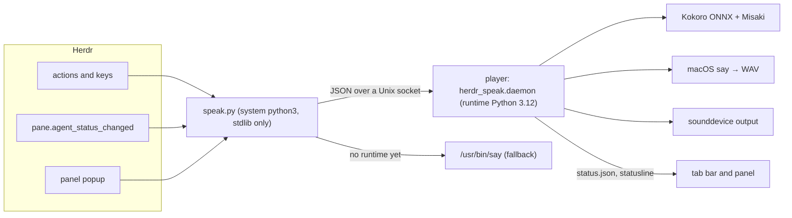

# Architecture

Speak has two halves: a launcher that Herdr runs for every action, event, and panel, and a player process that owns audio.

## Launcher

`speak.py` adds the plugin folder to `sys.path` and calls `herdr_speak.commands.main`. Everything it imports uses only Python's standard library and runs on Python 3.9, so actions work on a new Mac before any setup.

| Module | Role |
|---|---|
| `commands.py` | Command-line entry points for the manifest's actions, event hook, panel, and setup |
| `transcripts.py` | A pane's responses, one per turn, and what a blocked agent is asking for, from pi, Claude Code, Codex, and opencode transcripts |
| `playlist.py` | Play a pane's response by position; previous / next from what's playing or was last heard |
| `text.py` | Markdown to speakable paragraphs (code, tables read row by row, symbols, links), and the pieces that start speech fast |
| `autoread.py` | Event hook: per-pane status memory, scope, de-duplication, queueing |
| `client.py` | Starts the player on demand and sends it requests; `say` fallback without the runtime |
| `panel.py` | Tabbed popup: player, auto-read, voice, shortcuts, setup; dropdowns and the shared playback controls |
| `mini.py` | Mini player pane: opens, comes to the current tab, or closes (`mini-player`); follow mode on focus events; records its pane every 2 s via `herdr pane current --current`, which keeps working after Herdr moves the pane |
| `ui.py` | Drawing, keys, and SGR mouse clicks: segments with a key become clickable hotspots |
| `shortcuts.py` | Reads the user's Speak bindings from Herdr's `config.toml` |
| `bindings.py` | Writes Speak's key bindings and tab bar entry into Herdr's `config.toml` (free keys only, marked block, backup, reload check); `install.sh` calls it |
| `media.py` | Player only: macOS Now Playing and remote commands via PyObjC; command mapping kept PyObjC-free for tests |
| `icons.py` | Nerd Font and plain icon sets, one cell each, and Ghostty detection for `auto` |
| `config.py`, `catalog.py` | Settings, languages, voices, pinned model files |
| `runtime.py` | Setup: uv, Python 3.12 environment, model and voice downloads |
| `status.py` | Playback status file and the one-line tab bar summary |
| `paths.py` | Every file location |

Herdr starts a new process for each event. With auto-read off, the hook returns after reading `config.json`. With it on, `panes.json` (guarded by `flock`) remembers each pane's last status and the hash of the last response spoken, so a response is read once, after a working → idle/done transition.

## Player

`daemon.py` runs in the runtime environment. One instance per user is enforced with a lock file; it serves one JSON request per connection on `speakd.sock` in the state directory.

- **Queue**: items hold paragraphs, synthesized audio, and the voice settings captured when queued. Manual reads replace the queue; auto-reads append.
- **Synthesis thread**: synthesizes paragraph by paragraph for the current item and the next one, so playback starts after the first paragraph and continues without gaps.
- **Audio callback**: `Speaker.fill` copies samples from the current item at the play position. Pause writes silence; seek moves the position within the audio synthesized so far; reaching the end of a finished item advances the queue.
- **Media controls**: the player registers with `MPNowPlayingInfoCenter` and `MPRemoteCommandCenter` as an accessory app (no Dock icon) while it has something to play, and lets go when idle. Commands arrive on the main thread's run loop, so the housekeeping loop waits in `NSRunLoop` instead of sleeping.
- **Housekeeping** (4 times a second): writes `status.json` and the tab bar line, closes the audio stream 3 seconds after playback ends, and exits after `keep_alive_minutes` idle.

Kokoro follows the reference pipeline: Misaki converts text to phonemes (English with the spaCy small model and an espeak-ng fallback, other languages through espeak-ng), the phoneme count selects the voice's style vector, and ONNX Runtime generates 24 kHz audio. Chunks over 510 phonemes are split at word boundaries.

## Setup

`runtime.setup` is idempotent and resumable. It is run by Herdr's `[[build]]` step on `herdr plugin install` (which never fails the install), by the panel in the background, or by hand. The environment is rebuilt when `requirements.lock` changes, detected by its hash in `runtime/installed.json`. Downloads use `curl` with resume and are verified against sha256 values pinned in `catalog.py` and the lock file.

The data directory must stay at a short path: espeak-ng ignores data paths over about 160 characters. The player copies espeak's data to the user's private temp folder if the path is too long.

## Testing

| Test | Python | Covers |
|---|---|---|
| `test_text`, `test_transcripts`, `test_settings`, `test_autoread`, `test_runtime`, `test_manifest` | any 3.9+ | Pure logic, downloads via `file://` URLs, manifest consistency |
| `test_panel`, `test_ui` | any 3.9+ | Drive the panel and mini player in a pseudo-terminal, with keys and mouse clicks |
| `test_client` | any 3.9+ | The `say` fallback's queue and stop; pre-loading never failing |
| `test_mini` | any 3.9+ | Opening, bringing here, closing, and following, with Herdr mocked |
| `test_bindings` | any 3.9+ | Config edits: fresh and existing configs, taken keys, idempotence, removal, rejected reloads; TOML validity on 3.11+ |
| `test_media` | any 3.9+ | Media key and Control Center command mapping and Now Playing fields |
| `test_player` | with numpy | Queue, pause, seek, errors, audio-stream races, and the socket protocol with a fake engine and no audio device |
| `test_kokoro` | runtime installed | Real Kokoro synthesis (English, Spanish, over-long text) and `say` |

`scripts/test.sh` runs all of them that the machine supports. There is no hosted CI: run it locally before committing.
